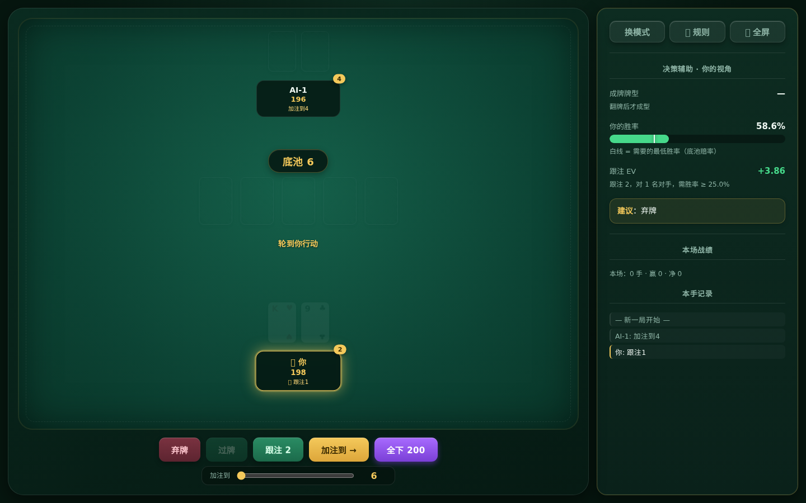

# dsh-game

Two practice tables in the DSH panel: heads-up Texas Hold'em with equity, pot odds and a recommendation, and Sichuan mahjong with shanten and discard hints.

**English** · [简体中文](README.zh-CN.md)

[](package.json)
[](LICENSE)



## The problem

Poker and mahjong practice tools are either online services that want an account, or desktop installs. This runs both behind the DSH login that is already there, as a small local process, so a hand never leaves the machine.

## Quick example

The backend is a FastAPI app on loopback. The browser never calls it directly: the panel uses DSH's own `/game/...` path, and the plugin proxies it.

```console
# after starting the backend (see Install)
$ curl -s http://127.0.0.1:8817/healthz
{"ok":true,"app":"dsh-game","version":"0.1.0"}

$ curl -s -X POST -H 'content-type: application/json' \
    -d '{"n_players":2}' http://127.0.0.1:8817/poker/api/new
{"game_id":"8d9a355b4d04","n":2,"street":"翻牌前","board":[],"pot":3,
 "hero_hole":["6s","7c"],"you_to_act":true,
 "equity":{"equity":0.4361,"win":0.406,"tie":0.0602,"need":0.25,"ev":1.18}, ...}
```

That equity block is what the right-hand panel shows during a hand. The same response carries the legal actions, the AI's actions and the result.

## Install

```bash
# 1) Plugin half
dsh plugin --profile web add /root/workspace/plugins/dsh-game
# then add "dsh-game" to dsh.profile.bundles, and restart DSH Web
systemctl restart deepseek-harness.service

# 2) Game half: FastAPI on 127.0.0.1:8817, using the system Python 3.11
#    (fastapi + uvicorn; this repo has no venv and no requirements file)
cd /root/workspace/plugins/dsh-game/server
/usr/bin/python3.11 -m uvicorn app.main:app --host 127.0.0.1 --port 8817
```

The backend is long-running, so in practice it belongs in a systemd unit. That unit is host configuration and is not part of this repository.

## Usage

1. Open **More** in the DSH sidebar and pick **德州扑克** or **麻将**. The panel opens on the matching tab.
2. Poker: **开始牌局** deals a heads-up hand. Your cards are face up, the action buttons are below, and the right column shows hand strength, equity, pot odds, call EV, a recommendation and the hand history.
3. Mahjong: **开始牌局**, choose the missing suit (定缺), then draw and discard. Fourteen tiles means it is your turn to discard; the recommended tile is marked.
4. The toolbar has **返回对话**, **刷新** and **新窗口打开**. Switching tabs points the iframe at the other game; the backend keeps both games alive.

## Configuration

| Where | Key | Meaning |
| --- | --- | --- |
| Host environment | `DSH_GAME_UPSTREAM_PORT` | Upstream port the proxy forwards to. Default `8817`. |
| `lib/index.js` | `UPSTREAM_TIMEOUT_MS` | Upstream timeout in milliseconds. Default `10000`; a code constant, not an environment variable. |
| Verification only | `DSH_GAME_VERIFY_PORT` | Port the app suite starts its own backend on. Default `8917`. |
| Verification only | `DSH_GAME_PROXY_TEST_PORT` | Port the host suite's temporary proxy listens on. Default `8898`. |

The backend itself reads no configuration: no database path, no storage, no model keys. Its only state is in process memory.

## What it doesn't do

- No persistence. A game lives in the uvicorn process and disappears on restart; multiple workers would each keep their own copy, so run a single worker.
- No authentication of its own. Port `8817` must stay on loopback; the only supported entry is DSH's `/game`.
- HTTP only, no WebSocket, and upstream calls are cut off after 10 seconds.
- No post-hand analysis or export, and no tutorial or rule text. The panel's session record and hand history are not saved either.
- The UI is Chinese, and the backend needs the system Python packages present. There is no `requirements.txt`.
- The client relies on the host-injected `react` and the optional UI primitives, and falls back to plain buttons without them.

## Docs

The Chinese README carries the deep sections: the proxy and auth path, the 44 assertions across three verification suites, the exact changes from the betterlife copy, and the full limitation list: [README.zh-CN.md](README.zh-CN.md).

## Contributing

Run `npm run check` and `npm run verify` before a patch. The verification scripts start and stop their own backend on a temporary port, so they do not need a running DSH instance, but they do use the Playwright copy installed on this machine.

## License

MIT. See [LICENSE](LICENSE).
